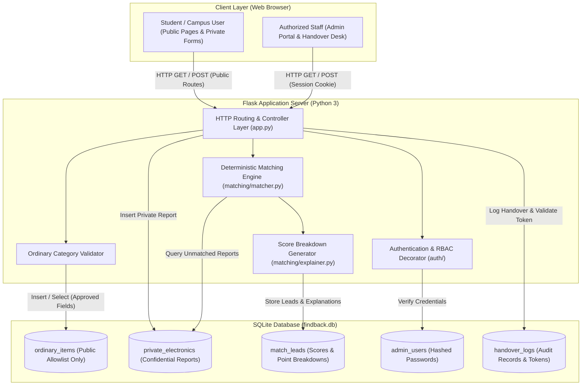
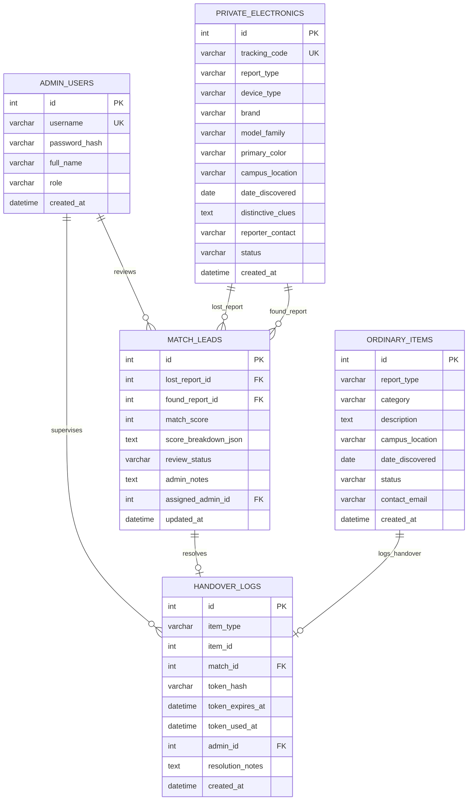

# FindBack 2.0 — System Architecture Document

**Document Version:** 1.0.0-draft  
**Target Audience:** First-Year Engineering Project Team, Faculty Reviewers, and Mentors  
**Document Status:** Proposed Architecture (Pending Team Approval)  

---

## 1. Architecture Overview

FindBack 2.0 is designed as a lightweight, modular **three-tier web application** built entirely with beginner-friendly technologies:
1. **Frontend (Browser Layer):** Clean, semantic HTML5 templates rendered server-side via Jinja2, responsive vanilla CSS3 stylesheets, and unobtrusive vanilla JavaScript for form validation and user feedback.
2. **Backend (Application Layer):** A Python application powered by the Flask micro-framework, responsible for request routing, input validation, server-side role-based access control (RBAC), and invoking the matching engine.
3. **Database (Data Layer):** A local SQLite relational database that maintains strict separation between public ordinary-item listings and confidential high-value electronics reports.
4. **Matching Engine Subsystem:** An explainable, deterministic Python scoring module that evaluates similarity between private lost and found electronics reports without external cloud dependencies.

### 1.1 Mermaid Component Diagram



### 1.2 Plain-Language Component Explanation
* **Browser Client:** What students and staff interact with on their laptops or phones. It submits forms and renders web pages sent by the Flask server.
* **Flask Router (`app.py`):** The central switchboard. When a user visits a URL (like `/report/ordinary`), the router decides which Python function processes the request.
* **Allowlist Validator:** A security gatekeeper. If someone tries to submit an unapproved category (e.g., "iPhone") to the public feed, this component immediately rejects it.
* **Deterministic Matching Engine:** A predictable Python algorithm that calculates similarity points between private lost and found electronics reports based on explicit rules.
* **SQLite Database:** A single-file database (`findback.db`) that permanently stores items, users, and audit logs on the computer running the server.

---

## 2. Proposed Folder Structure

The project structure is organized cleanly so that a four-member engineering team can divide responsibilities without causing merge conflicts:

```text
findback/
├── app.py                     # Flask application factory, routes, and error handlers
├── config.py                  # Application settings, secret keys, and database paths
├── database/
│   ├── __init__.py
│   ├── schema.sql             # SQL table definitions, constraints, and indexes
│   ├── db.py                  # SQLite connection helpers and parameterized query functions
│   └── init_db.py             # Script to initialize empty tables and insert test seed data
├── auth/
│   ├── __init__.py
│   ├── routes.py              # Login, logout, and credential management routes
│   └── session.py             # Server-side authentication decorator (@admin_required)
├── matching/
│   ├── __init__.py
│   ├── matcher.py             # Deterministic scoring algorithm and candidate comparison
│   └── explainer.py           # Human-readable score breakdown and evidence summary generator
├── static/
│   ├── css/
│   │   ├── style.css          # Core responsive styling, typography, and color variables
│   │   └── admin.css          # Styling for admin queues, match cards, and review modals
│   └── js/
│       ├── main.js            # Client-side input validation and dynamic alerts
│       └── admin.js           # Admin queue filtering and side-by-side clue toggling
├── templates/
│   ├── base.html              # Master layout (header, navigation, flash messages, footer)
│   ├── index.html             # Public feed of allowlisted ordinary items with search
│   ├── report_choice.html     # Workflow selector (Ordinary Item vs. Confidential Electronics)
│   ├── report_ordinary.html   # Allowlist-restricted ordinary item submission form
│   ├── report_electronics.html# Confidential electronics reporting form with credential warnings
│   ├── status_lookup.html     # Private report status checker (report ID lookup)
│   ├── admin/
│   │   ├── login.html         # Admin login screen with CSRF protection
│   │   ├── leads.html         # Lead queue with side-by-side clue comparisons and score badges
│   │   ├── disputes.html      # Conflicting claim adjudication and review screen
│   │   └── handover.html      # Desk handover confirmation and one-time token verification
│   └── errors/
│       ├── 400.html           # Bad request / allowlist validation error template
│       ├── 403.html           # Forbidden / unauthorized role access template
│       ├── 404.html           # Not found template
│       └── 500.html           # Server error template (sanitized, zero stack traces leaked)
├── tests/
│   ├── __init__.py
│   ├── conftest.py            # Pytest test fixtures (temporary in-memory SQLite DB, test client)
│   ├── test_db.py             # Database constraints, foreign keys, and query tests
│   ├── test_matcher.py        # Deterministic scoring algorithm unit tests and edge cases
│   ├── test_privacy.py        # Zero-leakage privacy boundary tests (UI, API, error templates)
│   ├── test_auth.py           # Admin authentication, session timeout, and RBAC tests
│   └── test_routes.py         # Ordinary form submissions and public feed route tests
├── docs/                      # Planning documents (PRD.md, ARCHITECTURE.md, etc.)
├── .gitignore                 # Environment files, virtual env, cache, and OS ignore rules
├── GEMINI.md                  # Project rules and engineering guidelines
├── README.md                  # Project overview and run instructions
└── requirements.txt           # Minimal Python dependencies (Flask, pytest, etc.)
```

> [!NOTE]
> This folder structure is documented as a proposed blueprint. No application files or directories are created at this stage.

---

## 3. Request and Data Flow

### 3.1 Ordinary-Item Reporting and Public-Browsing Flow

```
[Student Finder] ──(1) Submits Form──> [Flask Route: /report/ordinary]
                                             │
                                     (2) Category Allowlist Check
                                             │
                                      ┌──────┴──────┐
                               [Valid Category] [Invalid Category]
                                      │               │
                            (3) INSERT INTO           └──> Return HTTP 400
                            `ordinary_items`               "Category Not Allowed"
                                      │
                               (4) Redirect to /
                                      │
[Student Searcher] ──(5) Visits / ──> [Flask Route: /]
                                      │
                               (6) SELECT approved_fields 
                                   FROM `ordinary_items` 
                                   WHERE status = 'available'
                                      │
                               (7) Renders index.html ──> [Student Searcher]
```

1. **Submission:** The user submits a found/lost report for an ordinary item (e.g., water bottle).
2. **Server-Side Validation:** The backend checks the submitted category against the hardcoded allowlist. If invalid, the request is rejected immediately with HTTP 400.
3. **Database Insertion:** The item is stored in `ordinary_items` with initial status `available`.
4. **Public Browsing:** When any visitor requests `/`, the server executes a query requesting **only approved columns** (Category, Description, General Location, Date, Status). Private fields and email contacts are excluded from public list views.

### 3.2 Confidential Electronics Reporting, Matching & Supervised Handover Flow

```
[Student Loser/Finder] ──(1) Submits Form──> [Flask Route: /report/electronics]
                                                    │
                                            (2) Prohibited Credential Check
                                                (Rejects PINs/Passwords)
                                                    │
                                            (3) INSERT INTO `private_electronics`
                                                (Status: 'open')
                                                    │
                                            (4) Trigger Deterministic Matcher
                                                (Evaluates against opposite reports)
                                                    │
                                            (5) If Score >= Evaluation Threshold:
                                                INSERT INTO `match_leads`
                                                (Includes JSON breakdown)
                                                    │
                                    ┌───────────────┴───────────────┐
                                    ▼                               ▼
                      [Single High Lead]               [Multiple Competing Leads]
                            │                                       │
                Status: 'pending_review'                    Status: 'disputed'
                            │                                       │
                            └───────────────┬───────────────────────┘
                                            ▼
                    [Authorized Admin Reviews in /admin/leads]
                                            │
                                (6) Authorized In-Person Verification
                                    (Non-secret clues & evidence checked at desk)
                                            │
                                (7) Generate Single-Use Handover Token
                                            │
                                (8) Admin enters Token in /admin/handover
                                    (Token verified, marked used, logged)
                                            │
                                (9) Status updated to 'resolved'
```

1. **Confidential Submission:** The user submits device attributes (brand, model family, color, location) and safe ownership clues (wallpaper description, case color, stickers).
2. **Prohibited Credential Check:** Server-side regex and keyword checks ensure no unlock PINs, passwords, or recovery codes are submitted.
3. **Internal Matching:** The backend runs the deterministic matcher. If a match lead is identified, it is recorded in `match_leads` with a transparent score breakdown. Incompatible device types are halted immediately with zero points.
4. **Dispute Detection:** If multiple lost reports match the same found item, automatic progression is frozen and the records are marked `disputed`, preventing any handover until authorized human review occurs.
5. **Supervised Handover:** An authorized administrator reviews non-secret ownership clues and claimant evidence at the campus desk. The administrator supervises the physical handover and enters an expiring single-use verification token to record the procedure. The token confirms completion of the handover procedure; it does not independently prove ownership.

### 3.3 Error and Unauthorized Request Handling
* **Client Errors (HTTP 400 / 404):** Handled by custom Flask error handlers (`@app.errorhandler(400)` and `404`) returning clean, friendly templates.
* **Unauthorized Access (HTTP 401 / 403):** When an unauthenticated user attempts to access `/admin/*`, the server redirects them to `/admin/login` or returns an HTTP 403 template. No admin controls or data are leaked.
* **Server Errors (HTTP 500):** Generic, user-safe error template is returned. Internal exceptions and database errors are logged to the server console or local log file; **raw database errors and stack traces are never rendered to the user.**

---

## 4. Database Design

The database schema utilizes **SQLite** with foreign keys enabled (`PRAGMA foreign_keys = ON;`). It strictly separates public data from private reports.

### 4.1 Proposed Tables and Relationships



### 4.2 Table Specifications

#### 1. `admin_users`
* **Purpose:** Stores individual administrator credentials and roles.
* **Fields:** `id` (PK), `username` (UNIQUE), `password_hash` (salted hash via `werkzeug.security`), `full_name`, `role` (`admin` or `desk_staff`), `created_at`.
* **Security Rule:** Raw passwords must never be stored.

#### 2. `ordinary_items`
* **Purpose:** Stores lower-risk lost/found items on the approved allowlist.
* **Fields:** `id` (PK), `report_type` (`lost` or `found`), `category` (CHECK constraint: must be in allowlist), `description`, `campus_location`, `date_discovered`, `status` (`available`, `handover_pending`, `resolved`), `contact_email`, `created_at`.
* **Access Rule:** Public users can query category, description, location, date, and status. `contact_email` is restricted to authorized administrative processes.

#### 3. `private_electronics`
* **Purpose:** Stores confidential lost/found electronics reports.
* **Fields:** `id` (PK), `tracking_code` (UNIQUE alphanumeric code given to user for status checks), `report_type` (`lost` or `found`), `device_type` (`phone`, `laptop`, `tablet`, `earbuds`, `charger`, `smartwatch`), `brand`, `model_family`, `primary_color`, `campus_location`, `date_discovered`, `distinctive_clues` (wallpaper description, case, stickers), `reporter_contact` (student email/phone), `status` (`open`, `lead_identified`, `disputed`, `resolved`), `created_at`.
* **Security Rule:** **Never accessible via public queries.** Restricted entirely to internal matching and authenticated staff. Device unlock PINs, passwords, and biometrics are strictly prohibited from being collected or stored.

#### 4. `match_leads`
* **Purpose:** Stores prospective matches computed by the deterministic matching engine.
* **Fields:** `id` (PK), `lost_report_id` (FK $\rightarrow$ `private_electronics.id`), `found_report_id` (FK $\rightarrow$ `private_electronics.id`), `match_score` (INTEGER, 0–100), `score_breakdown_json` (JSON string containing factor points), `review_status` (`pending_review`, `investigating`, `disputed`, `approved`, `dismissed`), `admin_notes`, `assigned_admin_id` (FK $\rightarrow$ `admin_users.id`), `updated_at`.
* **Access Rule:** Accessible exclusively by authenticated staff.

#### 5. `handover_logs`
* **Purpose:** Stores an append-oriented audit log of every verified item handover completed by staff.
* **Fields:** `id` (PK), `item_type` (`ordinary` or `electronics`), `item_id`, `match_id` (FK $\rightarrow$ `match_leads.id`, nullable), `token_hash` (hashed single-use verification token), `token_expires_at`, `token_used_at` (nullable), `admin_id` (FK $\rightarrow$ `admin_users.id`), `resolution_notes`, `created_at`.
* **Prototype Limitations & Audit Integrity:** These records are designed to be append-only at the application level (no `UPDATE` or `DELETE` routes exist). However, because SQLite is a local file-based database, true physical or cryptographic immutability cannot be guaranteed against direct filesystem access on the local host. This operational limitation is documented for the prototype.

### 4.3 Sensitive Fields Matrix

| Table | Field Name | Sensitivity Level | Permitted Access Role | Exposure Rules |
| :--- | :--- | :--- | :--- | :--- |
| `admin_users` | `password_hash` | Critical | Auth backend only | Never rendered in UI or exposed in responses |
| `private_electronics`| `reporter_contact` | High (PII) | Authenticated Admin / Desk Staff | Never exposed in public views, feeds, or error templates |
| `private_electronics`| `distinctive_clues`| High (Private Clue) | Authenticated Admin / Desk Staff | Strictly restricted to admin review dashboard |
| `ordinary_items` | `contact_email` | Medium (PII) | Authenticated Admin / Desk Staff | Excluded from public list views |
| `match_leads` | `score_breakdown_json` | Medium | Authenticated Admin / Desk Staff | Only visible to authorized administrators |
| `handover_logs` | `token_hash` | High | Auth/Handover subsystem only | Raw token shown once; only hash stored in database |

---

## 5. Public / Private Boundary & Zero-Leakage Architecture

To guarantee student privacy and eliminate opportunistic claiming, the architecture enforces a strict public/private boundary across multiple layers:

### 5.1 Category Allowlist for Ordinary Items
Public listings are strictly constrained to this explicit allowlist:
1. `Water Bottles & Mugs`
2. `Notebooks, Binders & Textbooks`
3. `Umbrellas`
4. `Eyeglasses & Sunglasses`
5. `Non-Electronic Stationery`
6. `Outerwear, Jackets & Scarves`
7. `General Bags & Backpacks (Non-Electronic)`

Any submission with a category outside this list (or attempting to submit an electronic device to the public feed) is rejected by the backend validation layer.

### 5.2 Approved Public Query Projections
When querying the database for public views or public API endpoints, the application **must never use `SELECT *`**. Queries must explicitly project approved columns only:
```sql
SELECT id, category, description, campus_location, date_discovered, status 
FROM ordinary_items 
WHERE status = 'available';
```

### 5.3 Multi-Layer Zero-Leakage Defense
1. **Database Isolation & Projection Enforcement:** Ordinary items and private electronics live in separate tables. Public endpoints have no code pathways to query `private_electronics`. All queries powering public feeds strictly project approved ordinary item fields only.
2. **Strict Secrecy of Private Reports, Clues & Credentials:** Private electronics reports, student contact details, private ownership clues (such as wallpaper descriptions or case details), administrator credentials (`password_hash`), and application session secrets must **never** be included in public page contexts, public API responses, or client-side assets.
3. **Server-Side Authorization & Anti-Obscurity:** Admin routes (`/admin/*`) and administrative API actions enforce authorization strictly on the server (via `@admin_required`). The architecture forbids relying on hidden links, obscured URLs, or hidden UI buttons as access control.
4. **Sanitized Error Responses:** Custom error handlers (400, 401, 403, 404, 500) ensure that internal database exception messages, column names, session secrets, or stack traces are never exposed in browser responses or error templates.
5. **Two-Tier Privacy Testing:** Automated test suites verify privacy boundaries at both the HTTP/JSON payload level and the rendered HTML template level, verifying that unauthorized or public requests never leak private data under any circumstances.

---

## 6. Deterministic Matching Engine

The matching engine is implemented in pure Python (`matching/matcher.py`). It calculates an explainable, deterministic similarity score between an open lost report and an open found report.

> [!IMPORTANT]
> The proposed multi-factor scoring model and weights are **explicitly provisional**. An automated score serves strictly as an investigative lead for campus desk staff and **never constitutes proof of ownership**. No accuracy claims or performance guarantees are made for any score threshold until validated by empirical test results.

### 6.1 Multi-Factor Scoring Model (Provisional 0–100 Points)

| Factor | Provisional Points | Evaluation Rule |
| :--- | :---: | :--- |
| **1. Device Type Match** | **30 pts** | **Mandatory Invariant:** Must be an exact, compatible device type (e.g., `phone` == `phone`). If device types are incompatible (e.g., `phone` vs. `laptop`), **the comparison immediately halts, the score is set to 0, and no match lead can be produced**. |
| **2. Brand & Manufacturer**| **25 pts** | Exact case-insensitive match (e.g., `Apple` == `apple`) receives 25 pts. Recognized model family match adds high confidence. |
| **3. Primary Color Match** | **15 pts** | Normalized color matching (e.g., `black` == `black`, `dark gray` $\approx$ `black`). |
| **4. Campus Location** | **15 pts** | Same building/zone receives 15 pts; neighboring campus zone receives 5 pts; unknown/distant receives 0 pts. |
| **5. Time Window Plausibility**| **15 pts** | Found date must be on or after lost date. Found within 0–48 hours: 15 pts; within 3–7 days: 10 pts; within 8–14 days: 5 pts; > 14 days or found before lost: 0 pts. |

### 6.2 Explainability & Breakdown Generation
For every evaluated pair, `matching/explainer.py` generates a structured JSON object stored in `match_leads.score_breakdown_json`:
```json
{
  "total_score": 85,
  "factors": {
    "device_type": {"earned": 30, "max": 30, "status": "Exact Match (phone)"},
    "brand": {"earned": 25, "max": 25, "status": "Exact Match (Apple)"},
    "color": {"earned": 15, "max": 15, "status": "Exact Match (Black)"},
    "location": {"earned": 15, "max": 15, "status": "Same Zone (Library)"},
    "time_window": {"earned": 0, "max": 15, "status": "Found date precedes lost date"}
  },
  "summary": "Provisional lead: High similarity on device type, brand, color, and location. Discrepancy in date requires staff review."
}
```

### 6.3 Threshold Calibration & Dispute Protocol
* **Unvalidated 85% Benchmark:** The proposed 85% threshold is an unvalidated design hypothesis. The system provisionally categorizes scores $\ge 85$ as "High Confidence Leads" and scores between $60$ and $84$ as "Moderate Leads" for administrative review. Actual accuracy and precision will be measured and calibrated against test datasets; no claims of accuracy are made in advance.
* **Freeze on Competing Claims (Multi-Claimant Conflict):** If multiple lost reports match the same found device (or vice versa), the system **freezes automatic progression**, flags all competing records with `status = 'disputed'`, and blocks handover token generation until an authorized administrator conducts a human review.
* **Exclusion of Cloud AI:** Google Gemini API integration is excluded from the MVP and reserved strictly as an optional future enhancement after the deterministic engine is fully tested.

---

## 7. Authentication & Authorisation (RBAC)

Administrative features (viewing match leads, inspecting private clues, and logging handovers) require individual administrator accounts.

### 7.1 Understanding Flask Sessions: Signed Cookies vs. Server-Side Storage
A crucial architectural distinction for first-year engineers is how sessions operate in Flask:
* **Flask Signed Cookies Are Not a Server-Side Session Store:** By default, Flask serializes session dictionaries into client-side HTTP cookies signed cryptographically with `SECRET_KEY`. 
* **Signed vs. Confidential:** The cryptographic signature prevents users from *tampering* with the cookie contents, but the payload is **not encrypted**. Anyone can decode the base64 string and read the cookie's contents in their browser developer tools.
* **Strict Cookie Storage Invariant (DEC-07 Approved):** **Never store passwords, password hashes, roles, permissions, private report details, contact PII, or private ownership clues in session cookies.** Session cookies must hold ONLY the minimal non-sensitive identifier: `{"admin_user_id": <int>}` (and session CSRF token). Roles, permissions, and active status must be queried dynamically from SQLite on every protected request.

### 7.2 Comparison of Suitable Authentication Approaches

| Approach | Architecture Description | Pros for First-Year Team | Cons / Trade-offs |
| :--- | :--- | :--- | :--- |
| **Option A: Flask Built-in Signed Cookie Session (Approved DEC-07)** | Client-side signed cookie storing strictly integer `admin_user_id`. Server queries database on every protected request to re-verify existence, `is_active == 1`, and role permissions. | Zero additional dependencies; standard Flask library; easy to implement and debug. Immediate server-side revocation on account deactivation. | Signed cookie cannot be revoked without rotating `SECRET_KEY` unless dynamic database re-verification is enforced (as implemented in FindBack 2.0). |
| **Option B: Database-Backed SQLite Sessions** | Server generates a cryptographically random session token (`secrets.token_hex(32)`) sent in cookie. Token is looked up in an SQLite `admin_sessions` table (`session_token`, `admin_id`, `expires_at`). | Immediate server-side revocation on logout or timeout; full control over multi-device active sessions. | Requires creating and querying a dedicated session table on every request, plus writing an expiry cleanup routine. |

### 7.3 Approved Decision: DEC-07 Confirmed Architecture
* **Confirmed Resolution:** The project team approved **Option A (Flask Built-in Signed Cookie Session with Strict Dynamic Database Re-verification)**.
* **Key Implementation Invariants:**
  1. **Minimal Cookie Payload:** The signed cookie contains **strictly `admin_user_id`**. Roles (`admin`, `desk_staff`) and account active status (`is_active`) are NEVER written to the cookie.
  2. **Zero-Trust Role Check:** On every protected route request, the `@admin_required` decorator retrieves the user from SQLite (`SELECT id, username, full_name, role, is_active FROM admin_users WHERE id = ?`).
  3. **Immediate Server-Side Revocation:** If an administrator account is deactivated (`is_active = 0`) or deleted in SQLite, any subsequent request using an existing cookie fails closed immediately, clears the session, and redirects to `/admin/login`.
  4. **Session Fixation Defense:** Upon successful authentication, `session.clear()` is called before populating `session["admin_user_id"]`.
  5. **CSRF Protection:** Implemented in `auth/csrf.py` using Python's standard-library `secrets` and `hmac.compare_digest` with zero third-party dependencies.
  6. **Open Redirect Defense:** The `next` parameter is validated via `is_safe_url()` to ensure redirects only point to safe internal relative paths.

### 7.4 Security Baseline for Admin Access
Regardless of the session mechanism selected, the following security controls must be enforced:
1. **Password Hashing:** Passwords must never be stored in plain text. Passwords must be hashed using `werkzeug.security.generate_password_hash` with modern algorithms (PBKDF2/SHA-256) and verified using `check_password_hash`.
2. **Secure Cookie Configuration (in `config.py`):**
   * `SESSION_COOKIE_HTTPONLY = True`: Blocks client-side JavaScript access to prevent token theft via XSS.
   * `SESSION_COOKIE_SAMESITE = 'Lax'`: Protects cookies against Cross-Site Request Forgery (CSRF).
   * `SESSION_COOKIE_SECURE = True`: Enforces transmission strictly over HTTPS (configurable to `False` strictly for local HTTP development).
   * `PERMANENT_SESSION_LIFETIME = timedelta(minutes=60)`: Automatically expires inactive sessions after 60 minutes.
3. **Server-Side Access Control Decorator:** Every admin route (`/admin/*`) must be decorated with a custom `@admin_required` decorator that verifies an active session and checks the database for administrative role permissions. Unauthenticated requests are redirected to `/admin/login`.
4. **Explicit Logout:** Navigating to `/admin/logout` completely clears the session (`session.clear()`) and invalidates the cookie.
5. **CSRF Protection:** State-changing POST forms (such as updating dispute status or approving handovers) must validate a CSRF token to prevent cross-site request exploitation.

---

## 8. Handover Protocol & Audit Trail

Handover of high-value electronics must never be conducted unmonitored between students. It is always supervised at a campus desk.

### 8.1 Single-Use Handover Token Lifecycle

```
[Admin Approves Lead (admin role only)]
         │
         ▼
(1) Guard Check: can_lead_proceed_to_handover() verifies neither lead nor items are 'disputed'
         │
         ▼
(2) Generate random unpredictable token (e.g., 'HND-4928A3') via Python secrets module
         │
         ▼
(3) Compute SHA-256 hash of token; store strictly hash in `handover_logs.token_hash`
    Set `token_expires_at = now() + 30 minutes`
         │
         ▼
(4) Display raw token ONCE on /admin/token_issued receipt view (never redisplayed from DB)
         │
         ▼
[Claimant visits custody desk in person] ──> Staff conducts in-person checklist (Student ID + visual clues)
         │
         ▼
(5) Attending Officer (admin or desk_staff) enters token at /admin/handover
         │
         ▼
(6) Server validates:
    • SHA-256 hash matches a recorded record
    • Token is not expired (`now() <= token_expires_at`)
    • Token has not been consumed (`token_used_at IS NULL`)
    • Dispute recheck: neither lead nor underlying items have been flagged 'disputed'
         │
         ▼
(7) Atomic Compare-and-Swap Transaction:
    • Update `handover_logs` setting `token_used_at = now()` WHERE `token_used_at IS NULL`
    • Update `match_leads.review_status = 'approved'`
    • Update `private_electronics.status = 'resolved'` for both lost and found records
    • Record attending officer `admin_id` and resolution notes in audit log
```

### 8.2 Tiered RBAC & Handover Permissions Matrix
In Phase 8, the project enforces a server-side Tiered Role-Based Access Control model:
* **`admin` Role:** Full operational authority across the platform. Can inspect leads, transition review statuses (`investigating`, `disputed`, `dismissed`), adjudicate multi-claimant disputes, approve match leads, issue handover tokens, and redeem tokens at the desk.
* **`desk_staff` Role:** Front-desk operational authority. Can inspect the match queue, view the conflict adjudication queue, and redeem single-use handover tokens at the custody desk (`/admin/handover`). State-changing review actions (`POST /admin/leads/<id>/status` and `POST /admin/leads/<id>/approve`) are strictly restricted and return `HTTP 403 Forbidden` on the server.

### 8.2 Safe Verification & Audit Invariants
* **No Device Unlocking or Credential Disclosure:** Claimants are **never** required or asked to physically unlock a phone, laptop, or any other electronic device for the project team, nor reveal PINs, passwords, biometric credentials, or recovery codes.
* **Ownership Verification via Non-Secret Evidence:** Verification is conducted through non-secret item details (e.g., matching descriptions of lock-screen wallpaper, specific protective cases, stickers, scratches, or unique hardware markings) and claimant identity evidence reviewed by authorized staff.
* **Procedural Token Confirmation:** The single-use confirmation token serves strictly to confirm and log that the physical handover procedure was carried out by authorized personnel; the token does not independently prove ownership.
* **Zero Automatic Disclosure:** The system never automatically discloses student contact details upon finding a match lead. All communication and coordination must be mediated by authorized staff.
* **Append-Oriented Audit Records:** Handover records in `handover_logs` are managed as append-oriented logs protected by application-level permission checks (no `UPDATE` or `DELETE` operations exposed). While this prevents accidental tampering through the web interface, the team recognizes the prototype limitation that local SQLite files do not possess hardware-level immutability against direct host filesystem access.

---

## 9. Security, Privacy & Error Handling

### 9.1 Core Security Practices
* **Parameterized Queries:** All SQL queries must use SQLite `?` placeholders. String formatting (`f"SELECT ... {input}"`) is strictly prohibited to prevent SQL injection.
* **Input Sanitization:** User inputs are stripped of leading/trailing whitespace and validated against length constraints.
* **Prohibited Data Defense:** Form validators reject any text containing common password or PIN patterns.
* **Secret Management:** Application secret keys are retrieved via `os.environ.get('SECRET_KEY')` with a documented local development fallback in `config.py`. The `.env` file is ignored by Git.
* **Deferred Photo Uploads:** File/photo uploads are excluded from the MVP to eliminate multipart form security risks, file-type spoofing, and storage bloat.

### 9.2 Safe Error Handling
* Custom error templates (`400.html`, `403.html`, `404.html`, `500.html`) provide clear navigation back to safety.
* No internal exception details, database column names, or stack traces are ever displayed to users.

---

## 10. Technology Choices & Alternatives

| Component | Selected Technology | Why It Fits First-Year Team | Evaluated Alternative | Why Alternative Was Deferred |
| :--- | :--- | :--- | :--- | :--- |
| **Frontend** | Vanilla HTML5, CSS3, JavaScript | No build tools, zero npm dependencies, runs directly in any browser. | React / Vue / Tailwind | Heavy toolchain overhead (npm, Node.js, Webpack/Vite) creates unnecessary beginner friction. |
| **Backend** | Python 3 + Flask | Minimalist, clean syntax, gentle learning curve, readable routing. | Django | Django's built-in ORM and boilerplate are overly complex for a small, focused prototype. |
| **Database** | SQLite | Pre-installed with Python standard library; zero-configuration; single local file. | PostgreSQL / MySQL | Requires installing and running an external database server and managing network ports. |
| **Matching** | Deterministic Python scoring | Fully explainable, reproducible, testable, and transparent. | Google Gemini API | Cloud API integration is deferred until the rule-based baseline is built and empirically tested. |

---

## 11. Four-Person Team Ownership & Responsibilities

To ensure balanced learning and clear accountability, the project is structured across four primary engineering roles:

```
┌────────────────────────────────────────────────────────────────────────┐
│                   FindBack 2.0 Four-Member Team                        │
├───────────────────┬────────────────────┬───────────────────────────────┤
│ Role              │ Primary Member     │ Core Responsibilities        │
├───────────────────┼────────────────────┼───────────────────────────────┤
│ Member 1: Frontend│ UI & UX Lead       │ • Semantic HTML5 templates    │
│                   │                    │ • Responsive vanilla CSS      │
│                   │                    │ • Client-side form validation │
│                   │                    │ • Accessibility & UI polish   │
├───────────────────┼────────────────────┼───────────────────────────────┤
│ Member 2: Backend │ Routes & App Logic │ • Flask app factory & routing │
│                   │                    │ • Controller logic & forms    │
│                   │                    │ • Error handlers & redirects  │
│                   │                    │ • Request validation layer    │
├───────────────────┼────────────────────┼───────────────────────────────┤
│ Member 3: Database│ Data & Auth Lead   │ • SQLite schema & migrations  │
│                   │                    │ • DB helper functions & CRUD  │
│                   │                    │ • Admin password hashing      │
│                   │                    │ • Foreign key constraints     │
├───────────────────┼────────────────────┼───────────────────────────────┤
│ Member 4: Engine  │ Matcher & Testing  │ • Deterministic scoring logic │
│                   │                    │ • Breakdown generator         │
│                   │                    │ • Pytest automated test suite │
│                   │                    │ • Privacy boundary validation │
└───────────────────┴────────────────────┴───────────────────────────────┘
```

### Shared Team Responsibilities
* **Peer Code Reviews:** Every code change must be reviewed by at least one other team member before merging.
* **Cross-Subsystem Understanding:** Each member must be able to explain the entire system architecture during project presentations.
* **Joint Integration Sessions:** Team members integrate components together at the end of each development phase.

---

## 12. Open Decisions & Implementation Sequence

### 12.1 Unresolved Decisions Carried Forward from PRD.md

1. **Physical Handover Desk Location:** Which specific campus office will be designated in user instructions (e.g., Campus Security Office, Central Student Union Desk, or Main Library Desk)?
2. **Student Identity Verification Method:** Will searchers be required to provide a campus email format (`@campus.edu`), or will a general email address plus physical Student ID inspection at the desk suffice?
3. **Data Retention Policy:** How long should resolved or unclaimed records remain in the database before archiving or anonymization (e.g., 30 days vs. semester end)?
4. **Authentication & Session Strategy:** Will the team formally adopt Flask built-in signed cookies (Option A) or Database-Backed SQLite Sessions (Option B) for the administrative session layer?
5. **Score Weight Calibration:** What exact point weights will be assigned to physical attributes once initial empirical test fixtures are executed?

### 12.2 Phased Implementation Sequence

```
┌────────────────────────────────────────────────────────┐
│ Phase 1: Environment, Database & Core Skeleton         │
│ • SQLite schema, connection helpers, init_db.py        │
│ • Testing Gate: test_db.py passes (CRUD & constraints) │
└───────────────────────────┬────────────────────────────┘
                            │
┌───────────────────────────▼────────────────────────────┐
│ Phase 2: Ordinary Items Public Workflow                │
│ • Allowlist validator, reporting form, public feed     │
│ • Testing Gate: Category allowlist & public view tests │
└───────────────────────────┬────────────────────────────┘
                            │
┌───────────────────────────▼────────────────────────────┐
│ Phase 3: Confidential Electronics & Matching Engine    │
│ • Private forms, prohibited credential check           │
│ • Deterministic matcher and breakdown generator        │
│ • Testing Gate: test_matcher.py & test_privacy.py pass │
└───────────────────────────┬────────────────────────────┘
                            │
┌───────────────────────────▼────────────────────────────┐
│ Phase 4: Admin Portal & RBAC Security                  │
│ • Admin login, @admin_required decorator, lead queue   │
│ • Dispute adjudication interface                       │
│ • Testing Gate: test_auth.py passes (RBAC enforcement) │
└───────────────────────────┬────────────────────────────┘
                            │
┌───────────────────────────▼────────────────────────────┐
│ Phase 5: Supervised Handover & Audit Trail             │
│ • One-time token generation, verification, and logging │
│ • Testing Gate: Token lifecycle & audit tests pass     │
└───────────────────────────┬────────────────────────────┘
                            │
┌───────────────────────────▼────────────────────────────┐
│ Phase 6: End-to-End Polish & Verification              │
│ • Responsive CSS refinement, accessibility audit       │
│ • Testing Gate: 100% of all unit and boundary tests    │
└────────────────────────────────────────────────────────┘
```

> [!IMPORTANT]
> Each development phase has an explicit **Testing Gate**. The team must not proceed to the next phase until all automated unit tests for the current phase pass cleanly and have their actual results recorded.
