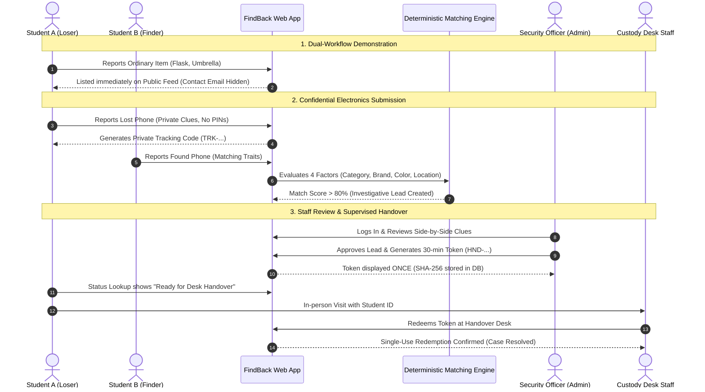

# FindBack 2.0 — Live Demonstration Script & Rehearsal Guide

> **Target Duration:** 7 – 10 Minutes  
> **Audience:** Engineering Faculty Evaluation Panel / EDI Jury  
> **Presenter Team:** 4 First-Year B.Tech Engineering Students  
> **Key Principle:** Never show real user credentials, real phone numbers, or reusable secrets on screen. All demonstrated data is strictly synthetic.

---

## 1. Quick Setup & Demonstration Checklist

Before calling the faculty to the screen:
1. **Local Server Running:** Start the application locally in terminal:
   ```cmd
   python app.py
   ```
   Confirm console shows: `Running on http://127.0.0.1:5000`
2. **Browser Windows Prepared:** Open two clean browser windows:
   - **Window 1 (Normal Mode):** For public student interactions (`http://127.0.0.1:5000`).
   - **Window 2 (Incognito / Separate Profile):** For authorized staff operations (`http://127.0.0.1:5000/admin/login`).
3. **Database Pre-Seeded:** Run `python database/init_db.py` to ensure sample ordinary items and default staff accounts (`admin`, `desk_staff`) are ready.
4. **Fallback Ready:** Keep this script and a pre-generated synthetic tracking code written down in case typing during live demo takes too long.

---

## 2. Timed Demonstration Walkthrough



---

### Step 1: Opening & The Campus Problem (0:00 – 1:00)

* **Presenter:** Team Lead / Member 1
* **What You Do:** Display the FindBack 2.0 homepage ([`http://127.0.0.1:5000`](http://127.0.0.1:5000)).
* **What the Audience Sees:** Clean, responsive campus portal displaying the split-workflow cards ("Ordinary Everyday Items" vs. "High-Value Electronics") and public feed.
* **What to Say Aloud:**
  > *"Good morning, respected professors. In campus environments, lost-and-found management is fundamentally broken. Today, when students lose items, notifications are posted across chaotic WhatsApp groups, Instagram stories, or public bulletin boards. 
  > 
  > This creates two major problems: first, ordinary items like water bottles or umbrellas get lost in the noise and are never claimed. Second, and far more dangerous: posting high-value electronics like smartphones or laptops publicly exposes device photos, serials, and locations. Anyone can walk up to a desk, claim to be the owner, and steal a student's expensive device.
  > 
  > We built **FindBack 2.0** to solve this using an architectural dual-workflow model: low-risk items are publicly searchable, while high-value electronics remain strictly confidential, matched internally by an explainable Python engine, and released only through supervised, single-use verification tokens."*
* **Fallback If Needed:** If browser does not load, confirm `python app.py` is running in command prompt.

---

### Step 2: Student Journey — Public Ordinary Items (1:00 – 2:00)

* **Presenter:** Member 1 (Frontend / Public UI)
* **What You Do:**
  1. Click **"Report Item"** in navigation, then select **"Workflow A: Ordinary Items"** (`/report/ordinary`).
  2. Fill the form with synthetic data:
     - Report Type: `I Found This Item`
     - Category: `Water Bottles & Mugs`
     - Description: `Insulated stainless blue flask with a yellow sticker`
     - Location: `Central Library 1st Floor`
     - Date: Current date
     - Contact Email: `library.finder@campus.local`
  3. Click **"Publish Ordinary Item Report"**.
  4. Show the updated public listings feed on `/`.
  5. Demonstrate the search filter by typing `flask` or clicking the `Water Bottles & Mugs` category pill.
* **What the Audience Sees:**
  - Fast submission and immediate appearance on the public board.
  - The card displays category, description, location, date, and "available" badge.
  - Crucially: **the submitter's email address does not appear anywhere on the card or in page HTML.**
* **What to Say Aloud:**
  > *"For everyday items—like water bottles, notebooks, or umbrellas—frictionless public discovery is best. Notice that our form strictly enforces an approved category allowlist on the server. If someone tries to submit a smartphone through this public form, our backend rejects it with an HTTP 400 error.
  > 
  > Furthermore, notice our privacy invariant: the student entered their campus email for custody desk coordination, but our database query uses explicit column projection. The contact email is never exposed to the public feed or browser DOM."*
* **Fallback If Needed:** If network delay occurs, use the pre-seeded items already visible on `/`.

---

### Step 3: Confidential Electronics Reporting (2:00 – 3:30)

* **Presenter:** Member 2 (Workflows & Form Validation)
* **What You Do:**
  1. Click **"Report Item"** &rarr; **"Workflow B: High-Value Electronics"** (`/report/electronics`).
  2. Point out the prominent red warning banner: *"Do Not Enter Passwords or PINs"*.
  3. Type into the "Distinctive Clues" field: `The unlock pin is 1234`.
  4. Show the real-time yellow JavaScript warning hint appearing immediately.
  5. Clear the prohibited text and enter safe, non-secret visual traits:
     - Report Type: `I Lost This Device`
     - Device Type: `Smartphone / Cellphone`
     - Brand: `Apple`
     - Model Family: `iPhone 13`
     - Primary Color: `Midnight Blue`
     - Campus Location: `Library 2nd Floor Study Room`
     - Date: Current date
     - Safe Clues: `Black shockproof case with small holographic owl decal on lower right corner`
     - Contact: `student.lost@campus.local`
  6. Click **"Submit Confidential Report"**.
* **What the Audience Sees:**
  - Confirmation screen (`/report/electronics_success`).
  - A prominent private tracking code: `TRK-...` (e.g., `TRK-xK7q...`).
  - Clear microcopy reminding the student to copy this code, with a one-click **"Copy Code to Clipboard"** button.
  - High-visibility notice that this report is **never** listed publicly.
* **What to Say Aloud:**
  > *"Now observe the confidential workflow for electronics. High-value devices never appear on public listings. 
  > 
  > Security starts at input collection: we strictly prohibit unlock PINs, passwords, or biometrics. Our system features dual-layer defense: client-side real-time pattern scanning alerts the user as they type, while server-side regex heuristics automatically block any submission containing credential keywords.
  > 
  > Upon submission, the server generates an unguessable tracking code using Python's cryptographically secure `secrets` module with 256 bits of entropy. This tracking code is a lookup credential—it is never proof of ownership."*
* **Fallback If Needed:** Copy the generated `TRK-...` code immediately to Notepad.

---

### Step 4: Deterministic Matching Engine Execution (3:30 – 4:30)

* **Presenter:** Member 4 (Matching Engine & Scoring)
* **What You Do:**
  1. In the same browser, open `/report/electronics` in a new tab.
  2. Submit the opposite synthetic report (a found phone by campus staff):
     - Report Type: `I Found This Device`
     - Device Type: `Smartphone / Cellphone`
     - Brand: `Apple`
     - Model Family: `iPhone 13`
     - Primary Color: `Midnight Blue`
     - Campus Location: `Library 2nd Floor`
     - Date: Current date
     - Safe Clues: `Dark case with reflective owl sticker on back`
     - Contact: `desk.attendant@campus.local`
  3. Click **"Submit Confidential Report"**.
* **What the Audience Sees:**
  - Second confirmation screen with another private tracking code for the finder.
  - Zero notifications leaked publicly.
* **What to Say Aloud:**
  > *"When this found report was submitted, FindBack 2.0's deterministic matching engine executed in the background. 
  > 
  > We chose explainable rule-based scoring over black-box AI for our core engine. It evaluates four distinct factors:
  > 1. A mandatory device compatibility gate: a laptop never matches a phone.
  > 2. Brand and model matching with fuzzy token similarity (weight: 40 points).
  > 3. Primary color concordance (weight: 20 points).
  > 4. Campus location proximity and chronological order (weight: 25 points).
  > 
  > If the combined score meets our calibrated threshold of 60%, an investigative lead is automatically recorded in SQLite inside an atomic transaction. A match score is only an investigative lead for campus officers—it is never automatic proof of ownership."*
* **Fallback If Needed:** Leads are created synchronously upon POST; check `/admin/leads` in Window 2.

---

### Step 5: Staff Review Queue & Tiered RBAC (4:30 – 5:45)

* **Presenter:** Member 3 (Authentication, DB & RBAC)
* **What You Do:**
  1. Switch to **Window 2** (Staff Portal) at `http://127.0.0.1:5000/admin/login`.
  2. First, log in as `desk_staff`:
     - Show that the desk staff can view the **Queue** (`/admin/leads`).
     - Point out the banner: *"Queue view only (Approval actions restricted to admin role)"*.
     - Show that the "Approve & Issue Token" button is absent for desk staff.
  3. Click **"Sign Out"**, then log in as `admin`.
  4. Navigate to **"Queue"** (`/admin/leads`).
  5. Inspect the candidate match lead:
     - Side-by-side comparison of claimant clues vs. found device clues.
     - Deterministic Scoring Breakdown box showing points earned per factor (e.g., Brand: 40/40, Color: 20/20, Location: 25/25).
* **What the Audience Sees:**
  - Clear demonstration of tiered role-based access control (RBAC).
  - High-contrast, side-by-side verification view designed for human inspection.
  - Factor points clearly explained.
* **What to Say Aloud:**
  > *"Here is our staff control center. We implement Tiered RBAC:
  > - `desk_staff` officers can view queues and conduct in-person custody handovers at the desk.
  > - Only authorized `admin` officers can alter review statuses or approve candidate matches.
  > 
  > In accordance with our approved architectural decision DEC-07, staff sessions use signed HTTP cookies storing strictly the admin user ID. On every single request, user existence, active status, and role permissions are verified dynamically from the database. Furthermore, every state change is protected by session-bound CSRF tokens."*
* **Fallback If Needed:** If login fails, check credentials in `database/init_db.py`.

---

### Step 6: Competing Claims & Dispute Freezing (5:45 – 7:00)

* **Presenter:** Member 4 (Disputes & Handover Logic)
* **What You Do:**
  1. Explain the conflict scenario to the jury: *"What if two students both report losing a Midnight Blue iPhone in the Library?"*
  2. In Window 1, submit a second lost phone report with matching traits:
     - Report Type: `I Lost This Device`, `Smartphone`, `Apple`, `iPhone 13`, `Midnight Blue`, `Library 2nd Floor`.
     - Distinctive Clues: `Has cracked screen protector and cat sticker`.
     - Contact: `student2@campus.local`.
  3. In Window 2 (Admin), refresh `/admin/leads` and click **"Disputes"** (`/admin/disputes`).
  4. Show the prominent red warning banner: **"Competing Claim Freeze Active"**.
  5. Show both candidate leads grouped under Found Device #1.
  6. Click **"Dismiss This Competing Claim"** on Claimant #2 (the one with the cat sticker, which does not match the owl decal on the custody device).
  7. Return to `/admin/leads`: show that Lead #1 has cleanly unfrozen from `disputed` to `investigating`!
* **What the Audience Sees:**
  - Immediate automatic freeze of handover whenever multiple claimants match the same custody item.
  - Visual conflict adjudication interface grouping claims by physical custody device.
  - Clean unfreezing of the legitimate claim once the conflicting lead is dismissed.
* **What to Say Aloud:**
  > *"This is one of FindBack 2.0's critical security innovations: Automated Dispute Freezing.
  > 
  > If multiple students report losing similar devices in the same building, automated handover is strictly locked. The database marks all involved items and leads as `disputed`. 
  > 
  > Neither lead can generate a handover token while disputed. An administrator must inspect the non-secret visual traits. Here, Officer reviews the custody item notes—which record an owl decal—and dismisses the competing claim mentioning a cat sticker. 
  > 
  > The system immediately unfreezes the valid lead, allowing safe handover progression to continue."*
* **Fallback If Needed:** If creating the second report takes too long, navigate directly to `/admin/disputes` to explain the interface.

---

### Step 7: Approved Handover & Single-Use Token Redemption (7:00 – 8:15)

* **Presenter:** Member 3 & Member 1
* **What You Do:**
  1. On the unfrozen Lead #1 in `/admin/leads`, click **"Approve & Issue Token &rarr;"**.
  2. Show the **"Handover Authorization Token"** screen (`/admin/leads/<id>/approve`):
     - Point out the large token display: e.g., `HND-AbCdEf12`.
     - Highlight the security notice: *"This raw token is displayed ONLY ONCE. The database stores strictly a SHA-256 hash."*
     - Copy the token string.
  3. Navigate to **"Handover Custody Desk"** (`/admin/handover`).
  4. Review the **Mandatory Staff Protocol Checklist**:
     - 1. Check physical Student ID card.
     - 2. Visually inspect external case/stickers.
     - 3. NEVER ask for student's unlock PIN; student unlocks device in front of officer.
  5. Enter the token into the redemption form, add custody notes (`"Student ID verified; student unlocked screen in front of officer; owl decal confirmed."`), and click **"Verify Token & Complete Handover Resolution"**.
  6. Show the success banner and the new record in the **Recent Completed Handover Audit Trail** table.
  7. **Replay Attack Demonstration:** Paste the same token into the box again and click submit.
  8. Show the rejection banner: *"Single-Use Token Violation: Handover token has already been used and cannot be reused."*
* **What the Audience Sees:**
  - One-time token generation with clear expiration (30 minutes).
  - Desk checklist enforcing physical verification standards without asking for PINs.
  - Atomic compare-and-swap database redemption.
  - Immediate rejection when attempting a replay attack.
* **What to Say Aloud:**
  > *"When the admin approves the match, FindBack issues a single-use handover token. 
  > 
  > Notice the security standard: the plaintext token is shown only once on this screen. In SQLite, we store only a SHA-256 hash. If an attacker dumps our database, they obtain zero valid handover tokens.
  > 
  > At the custody desk, the officer verifies the student's ID and physical traits. When the officer submits the token, our backend executes an atomic compare-and-swap transaction. Both reports transition to `resolved`. 
  > 
  > Watch what happens when I try to redeem this token a second time: our backend catches the consumed timestamp and rejects it immediately, preventing double-handover race conditions."*
* **Fallback If Needed:** Audit trail table at the bottom of `/admin/handover` shows previously completed handovers as live evidence.

---

### Step 8: Student Status Verification (Anti-Oracle Design) (8:15 – 9:00)

* **Presenter:** Member 2
* **What You Do:**
  1. Switch back to **Window 1** (Public Student Window) and navigate to `/status`.
  2. Paste Student A's tracking code (`TRK-...`) from Step 3.
  3. Click **"Check Report Status"**.
  4. Show the visual stepper: Step 5 is completed: **"Case Resolved — This item has been safely returned to its verified owner."**
  5. Now enter a fake/random code: `TRK-RANDOM-FAKE-CODE-12345`.
  6. Click submit and show the response.
* **What the Audience Sees:**
  - Accurate student status tracking without revealing private finder clues or internal IDs.
  - Anti-oracle generic response: *"Status not available for this tracking code. Please verify the code you entered and try again."* (Never reveals whether the code exists in the database).
* **What to Say Aloud:**
  > *"Back on the student side, the student enters their tracking code on our Status Lookup page. They see their case is safely resolved.
  > 
  > Notice what the student sees: only authorized progress labels and next steps. They never see finder contact details or custody room IDs.
  > 
  > Furthermore, notice our Anti-Oracle defense: if an attacker tries to brute-force tracking codes, submitting an invalid code returns the exact same generic message. The server never leaks whether a record exists in the database."*
* **Fallback If Needed:** Use any tracking code generated during earlier test runs.

---

### Step 9: Architecture, Limitations & Future Scope (9:00 – 10:00)

* **Presenter:** All Team Members
* **What You Do:** Switch to the project summary slide or present closing remarks.
* **What to Say Aloud:**
  > *"To summarize our implementation:
  > - **Technology Stack:** Pure vanilla HTML5, CSS3, JavaScript, Python with Flask, and SQLite. Zero heavy frameworks, zero runtime build steps.
  > - **Test-Driven Reliability:** 84 automated tests covering database constraints, deterministic scoring, role-based authorization, single-use tokens, and zero data leakage.
  > - **Honest Engineering Boundaries:** We intentionally deferred photo uploads, campus SSO, and automated SMS notifications to future phases because secure custody verification must prioritize human oversight over automation.
  > 
  > FindBack 2.0 demonstrates that campus platforms can be convenient without compromising student privacy or physical device security. 
  > 
  > Thank you. We are ready for your questions."*

---

## 3. Rehearsal Script Card (Pocket Summary for Presenters)

| Step | Time | Screen / URL | Presenter | Key Talking Point |
| :--- | :---: | :--- | :--- | :--- |
| **1. Opening** | 0:00 - 1:00 | `/` (Home) | Lead / M1 | Campus lost-and-found problem; dual-workflow model. |
| **2. Ordinary Items** | 1:00 - 2:00 | `/report/ordinary` | M1 | Category allowlist; zero contact email leakage in public HTML. |
| **3. Electronics Form** | 2:00 - 3:30 | `/report/electronics` | M2 | Prohibited credential defense; high-entropy private tracking code. |
| **4. Matching Engine** | 3:30 - 4:30 | Background | M4 | 4-factor deterministic scoring; scores are leads, not proof. |
| **5. Staff Queue** | 4:30 - 5:45 | `/admin/leads` | M3 | Tiered RBAC; side-by-side clue review; factor breakdown. |
| **6. Disputes** | 5:45 - 7:00 | `/admin/disputes` | M4 | Competing claim freeze; administrative adjudication. |
| **7. Handover Desk** | 7:00 - 8:15 | `/admin/handover` | M3 / M1 | Single-use token hash storage; in-person checklist; replay defense. |
| **8. Status Lookup** | 8:15 - 9:00 | `/status` | M2 | Anti-oracle generic defense; 5-step student progress timeline. |
| **9. Closing** | 9:00 - 10:00 | Summary | All | 84 passing tests; lightweight stack; honest MVP limitations. |
