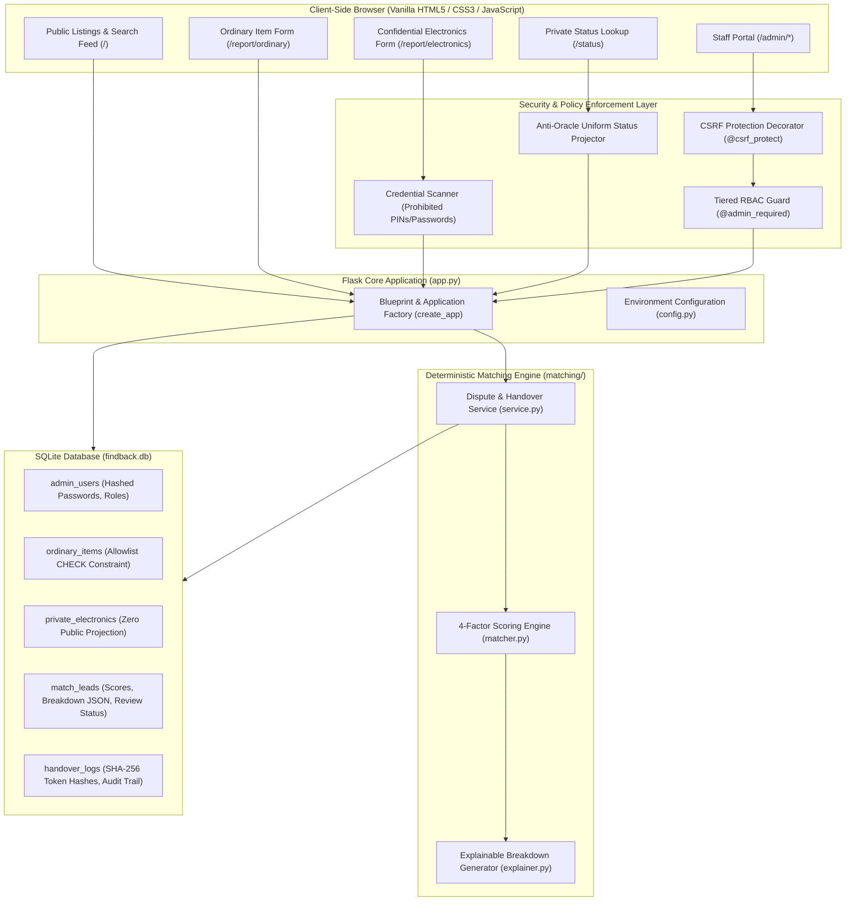

# FindBack 2.0 — Engineering Design & Innovation (EDI) Presentation Notes

## 1. Project Title & Overview

* **Project Title:** FindBack 2.0 — Campus Custody & Safe Handover System
* **Academic Level:** First-Year B.Tech Engineering Design & Innovation (EDI) Project
* **Technology Stack:** Pure HTML5, CSS3, JavaScript, Python with Flask, SQLite 3
* **Repository:** `https://github.com/omg72637-cell/findback.git`
* **Test Verification Baseline:** 84 Passing Automated Tests (0 Failures)

---

## 2. Problem Statement & Campus Motivation

### The Problem
On modern university campuses, managing lost property is unorganized and high-risk:
1. **Public Social Media Chaos:** Lost items are routinely photographed and posted to large WhatsApp groups, Reddit threads, or Instagram stories.
2. **Opportunistic Theft:** When an expensive device (e.g. an iPhone 13 or MacBook Pro) is posted publicly with photos and location details, unauthorized individuals walk up to custody desks and falsely claim the item using the public photos as evidence.
3. **Student Privacy Exposure:** Public lost-and-found posts often leak phone numbers, full names, student IDs, and device serial numbers.
4. **Friction for Everyday Items:** Conversely, everyday low-value possessions (water bottles, umbrellas, notebooks) are rarely claimed because there is no searchable central board.

### Project Objectives
1. **Dual-Workflow Architecture:** Split lost-and-found operations into two distinct pipelines:
   - *Public Self-Service:* For ordinary everyday items on an approved allowlist.
   - *Confidential Private Custody:* For high-value electronic gadgets, completely hidden from public listings.
2. **Explainable Deterministic Matching:** Replace opaque black-box AI with a transparent, rule-based Python scoring engine that provides clear factor breakdowns for staff inspection.
3. **Automated Dispute Freezing:** Automatically lock handover when multiple competing claimants match the same custody item until an administrator adjudicates the conflict.
4. **Supervised Single-Use Token Handover:** Release high-value devices only through in-person physical inspection and cryptographic, single-use verification tokens valid for 30 minutes.

---

## 3. System Architecture & Component Mapping

### Architectural Highlights
1. **Frontend:** Clean, responsive HTML5/CSS3 with zero JavaScript framework dependencies (no React, Vue, or npm build pipelines). High-contrast WCAG AA styling with keyboard-accessible navigation (`.skip-link`).
2. **Backend:** Python 3 with Flask application factory (`create_app`). State-changing endpoints enforce session-bound CSRF tokens. Protected staff endpoints check user existence and role dynamically from SQLite on every request (DEC-07).
3. **Database Integrity:** SQLite with `PRAGMA foreign_keys = ON;`, strict schema CHECK constraints, and 100% parameterized queries (`?` placeholders).
4. **Zero-Leakage Invariant:** Private electronics records, tracking codes, contact details, and clues are strictly excluded from public queries. Public feed queries explicitly project only necessary ordinary columns.

---

## 4. Innovation & Key Differentiators

| Feature | Typical Campus System | FindBack 2.0 |
| :--- | :--- | :--- |
| **Electronics Visibility** | Photos & serials posted publicly on WhatsApp/Instagram | **Never published.** Private records processed exclusively by internal engine. |
| **Credential Collection** | Staff or forms ask for device unlock PINs / passwords | **Strictly prohibited.** Heuristic filter blocks PINs; staff inspect external non-secret clues only. |
| **Matching Logic** | Manual human scrolling or unpredictable AI chat prompts | **Deterministic 4-factor scoring** with mathematical weights and transparent explanations. |
| **Competing Claims** | First person to show up at security takes the device | **Automated dispute freeze.** Handover is locked until administrative adjudication. |
| **Handover Security** | Informal sign-out sheet with physical signatures | **Expiring single-use token** with SHA-256 hash storage and replay attack prevention. |
| **Status Transparency** | Students must repeatedly visit or call security office | **Private 5-step status stepper** with anti-oracle defense against brute-forcing. |

---

## 5. Team Work Division & Presenter Roles

Team ownership is divided into four distinct components. Every member can explain their own module as well as the overarching system integration:

| Member / Role | Focus Area | Core Deliverables & Code Symbols |
| :--- | :--- | :--- |
| **Member 1: [Student Name / ID]** *Frontend UI & Accessibility* | Client-Side Presentation, Responsive Layout & WCAG Accessibility | HTML templates (`base.html`, `index.html`, `report_choice.html`), CSS architecture (`style.css`), keyboard skip-link, touch target compliance, client-side prohibited credential warning hint. |
| **Member 2: [Student Name / ID]** *Flask Routes & Workflows* | Backend Route Architecture, Form Validation & Status Lookup | `app.py` route handlers (`/report/ordinary`, `/report/electronics`, `/status`), anti-oracle uniform status projection, input sanitization, allowed device type mappings, application factory. |
| **Member 3: [Student Name / ID]** *Database, Auth & Handover Desk* | SQLite Schema, Authentication, Session Security & Handover Desk | `database/schema.sql`, `database/init_db.py`, `auth/csrf.py`, `auth/decorators.py` (`@admin_required`, `@csrf_protect`), password hashing with Werkzeug, signed-cookie sessions (DEC-07), single-use token redemption and replay defense. |
| **Member 4: [Student Name / ID]** *Matching Engine & Test Verification* | Deterministic Scoring Algorithm, Dispute Freezing & Test Suites | `matching/matcher.py` (4-factor scoring logic), `matching/explainer.py` (breakdown generator), `matching/service.py` (dispute freezing & unfreezing), test suites in `tests/` (84 automated tests across 8 test modules). |

---

## 6. Honest Limitations & Open Decisions (DEC-08 to DEC-12)

In engineering design, knowing what *not* to build prematurely is as important as building the core system. The following decisions were explicitly evaluated and preserved as requiring future faculty/administrative approval:

1. **DEC-08: Photo & Image Uploads (Deferred):**
   - *Reason:* Image file uploads introduce attack vectors (malicious payload execution, server storage exhaustion) and AI image detectors are prone to false accusations. The MVP relies on structured visual traits and physical in-person inspection.
2. **DEC-09: Automated Outbound Email / SMS Alerts (Deferred):**
   - *Reason:* Automated SMS/email requires third-party API credentials (e.g. Twilio/SendGrid) and paid gateways. The prototype utilizes pull-based private status lookups.
3. **DEC-10: Campus Single Sign-On / OAuth Integration (Deferred):**
   - *Reason:* Integrating with live campus Active Directory / SAML SSO requires institutional security permissions. The MVP implements independent hashed staff credentials.
4. **DEC-11: Device Serial Number & IMEI Storage (Deferred):**
   - *Reason:* Storing IMEI and hardware serial numbers in a web database creates high-value honeypot targets. Physical custody inspection checks hardware markings directly.
5. **DEC-12: Physical Custody Desk Storage Location Schemas (Deferred):**
   - *Reason:* Physical shelf/locker/bin allocation varies across campus buildings.

---

## 7. Anticipated Faculty Questions & Defensible Answers

### Q1: Why not just use an AI Large Language Model (like Gemini or GPT) to match lost and found items?
> **Answer:** *"While LLMs are powerful for text generation, using an LLM as the core matching engine introduces non-determinism, hallucinations, and unpredictable scoring variance. If two students submit reports, an LLM might score them 90% today and 65% tomorrow. 
> 
> In FindBack 2.0, fairness and accountability are paramount. We built an explainable, deterministic Python scoring algorithm based on mathematical weights (brand/model, color, location, and time). Every point earned is recorded in a transparent factor breakdown that staff can audit. As noted in `GEMINI.md`, AI assistance will only be evaluated as a secondary suggestion layer after rule-based scoring is calibrated."*

### Q2: How do you prevent opportunistic theft if high-value electronics are never displayed publicly?
> **Answer:** *"That is precisely why they are not displayed publicly. Opportunistic theft occurs when a dishonest individual sees a photo of a lost laptop on a public feed, learns its exact stickers, and claims it before the true owner arrives. 
> 
> By keeping reports strictly confidential, only the true owner who knows the specific non-secret external traits (such as case texture, lockscreen wallpaper subject, or decal placement) can match the item. Furthermore, handover requires in-person presentation of a physical Student ID and a single-use authorization token valid for only 30 minutes."*

### Q3: What is the 'Anti-Oracle' status lookup and why is it necessary?
> **Answer:** *"In cryptography and application security, an 'oracle' is an endpoint that leaks information about internal database state based on error messages. If submitting an invalid tracking code returned 'Code not found in database', an attacker could write a script to brute-force valid codes. 
> 
> FindBack 2.0 returns an identical, uniform HTTP 200 message ('Status not available for this tracking code') whether the code is malformed, non-existent, or simply has no match yet. It never confirms or denies database presence."*

### Q4: Why are staff forbidden from asking students for their device unlock PIN or password?
> **Answer:** *"Unlock PINs and passwords are master encryption keys. If campus security staff routinely ask students to disclose their PINs, two critical risks emerge:
> 1. Staff gain unrestricted access to the student's personal messages, photos, banking apps, and campus accounts.
> 2. It normalizes unsafe credential sharing, making students vulnerable to social engineering.
> 
> Under FindBack 2.0's supervised handover protocol, staff verify external non-secret physical traits. If device unlocking is required to confirm ownership, the student unlocks their own screen in front of staff without disclosing the PIN."*

### Q5: How does the system handle competing claims when two people claim the same device?
> **Answer:** *"Our matching engine automatically detects item-level competing claims. If Found Phone #1 generates a match lead with Lost Report A, and a second student submits Lost Report B which also matches, the system flags both leads and all involved item records as `disputed`. 
> 
> This triggers an automatic server-side dispute freeze: neither lead can generate a handover token. On the staff dashboard, candidate claims are grouped under the physical custody device for neutral human review. An administrator inspects the clues and dismisses invalid claims, which cleanly unfreezes the valid lead."*

### Q6: How do you prevent someone from reusing a handover token or redeeming it twice?
> **Answer:** *"We enforce three layers of token defense:
> 1. **Expiration:** Tokens are valid for exactly 30 minutes from generation.
> 2. **Hash-Only Storage:** Only the SHA-256 hash is stored in `handover_logs`. The plaintext token is displayed once to the admin and never persisted.
> 3. **Atomic Compare-and-Swap:** When redeemed at the desk, the database query executes:
>    `UPDATE handover_logs SET token_used_at = ? WHERE id = ? AND token_used_at IS NULL`.
>    If `rowcount == 0`, the server catches that the token was already consumed or concurrently redeemed and immediately aborts the transaction with an HTTP 400 Single-Use Token Violation."*

### Q7: Why did you choose signed-cookie sessions instead of JWTs or server-side Redis sessions?
> **Answer:** *"In accordance with approved decision DEC-07, we use Flask's cryptographically signed cookie sessions, storing strictly the `admin_user_id`. 
> 
> Storing roles or permissions inside JWTs creates a major vulnerability: if an admin is demoted or an account is deactivated, a signed JWT remains valid until expiration unless a revocation list is maintained. In FindBack 2.0, the cookie stores only the user ID; on every single protected request, the server queries the database to confirm the account exists, is active, and possesses the required role. Changes to staff permissions take effect instantaneously."*

### Q8: How did you ensure SQL injection safety across the entire codebase?
> **Answer:** *"Every database interaction across `app.py`, `matching/`, and `database/` uses parameterized queries with `?` placeholders executed through Python's standard `sqlite3` driver. We ran an automated Abstract Syntax Tree (AST) code audit across all project files to confirm zero string concatenations, f-strings, or `.format()` calls exist in SQL statements."*

### Q9: What happens if someone submits an ordinary item through the public form with a phone or laptop category?
> **Answer:** *"The ordinary item form is restricted by an approved 7-category allowlist. While the HTML frontend provides a dropdown, client-side controls can be bypassed using tools like Postman or curl. Therefore, our backend route (`/report/ordinary`) validates the category on the server against `ORDINARY_ALLOWLIST`. Any unapproved category is rejected with an HTTP 400 Bad Request error."*

### Q10: What are the next technical milestones if this project receives funding or campus approval?
> **Answer:** *"The next milestones correspond to our documented future scope:
> 1. Integration with Campus Active Directory / SSO via OAuth2/SAML.
> 2. Migration from single-worker SQLite to PostgreSQL with WAL mode for multi-desk concurrency.
> 3. Secure outbound SMS/email notifications via campus communication relays.
> 4. Physical bin/shelf barcode tracking for custody warehouse storage."*
