# FindBack 2.0 — Comprehensive User & Operations Guide

## 1. System Overview & Purpose

**FindBack 2.0** is an educational engineering prototype designed to address the unique challenges of campus lost-and-found management. Traditional campus systems suffer from either excessive friction (requiring long physical visits to distant security offices) or severe security risks (broadcasting photos of expensive lost smartphones on public social media channels, leading to opportunistic theft).

FindBack 2.0 introduces an architectural **dual-workflow model**:
1. **Workflow A (Public Ordinary Items):** Everyday low-risk personal possessions (water bottles, notebooks, umbrellas, eyeglasses) are openly browsable on a campus board for quick self-service claiming.
2. **Workflow B (Confidential High-Value Electronics):** High-value devices (smartphones, laptops, tablets, wireless earbuds, smartwatches, chargers) are **strictly private**. They are never displayed on public feeds. Reports are matched internally via a transparent, deterministic scoring engine and released exclusively through supervised physical verification at the campus custody desk.

---

## 2. User Roles & Permission Boundaries

FindBack 2.0 enforces three distinct operational roles:

| Role | Target Users | Access Scope | State-Changing Privileges |
| :--- | :--- | :--- | :--- |
| **Public / Student** | All campus students, faculty, and visitors | Public feed (`/`), Reporting Gateway (`/report`), Status Lookup (`/status`) | Can submit ordinary reports and confidential electronics reports. Cannot view any private electronics data. |
| **Desk Staff (`desk_staff`)** | Central Lost & Found Custody Desk Attendants | Match Queue (`/admin/leads`), Disputes Queue (`/admin/disputes`), Custody Desk (`/admin/handover`) | Can inspect queues and redeem handover authorization tokens at the desk. **Cannot approve leads, dismiss leads, or alter review statuses (HTTP 403 Forbidden).** |
| **Administrator (`admin`)** | Campus Security Officers, Designated Staff Leads | Full administrative portal (`/admin/*`) | Can review leads, update investigation statuses, adjudicate competing disputes, approve leads, issue handover tokens, and execute custody releases. |

---

## 3. Workflow A: Public Ordinary Items

### 3.1 Approved Item Categories (Strict Allowlist)
To protect students from accidentally listing valuable items on the open web, the ordinary form strictly restricts submissions to seven approved categories:
1. `Water Bottles & Mugs`
2. `Notebooks, Binders & Textbooks`
3. `Umbrellas`
4. `Eyeglasses & Sunglasses`
5. `Non-Electronic Stationery`
6. `Outerwear, Jackets & Scarves`
7. `General Bags & Backpacks (Non-Electronic)`

*Attempting to submit an electronic device or unapproved category to this form is automatically rejected with an HTTP 400 Validation Error.*

### 3.2 Reporting an Ordinary Item
1. Navigate to **Report Item** in the navigation bar and select **Workflow A: Ordinary Items** (`/report/ordinary`).
2. Select whether you **Found** or **Lost** the item.
3. Choose the category from the dropdown menu.
4. Provide a descriptive summary (e.g., *"750ml blue stainless-steel insulated bottle with dent on base"*).
5. Specify the campus location (e.g., *"Science Block C, 2nd Floor Lounge"*).
6. Enter the date discovered.
7. Enter your campus contact email.
8. Click **Publish Ordinary Item Report**.

### 3.3 Privacy Invariant on Public Feed
- The report appears immediately on the public feed (`/`).
- Students can search listings using keywords in the search bar or filter by category pills.
- **Privacy Guarantee:** The reporter's `contact_email` is stored in the database for staff record-keeping, but **is never rendered in the public feed HTML or DOM**. Ordinary items instruct students to inquire directly at the Central Campus Custody Desk.

---

## 4. Workflow B: Confidential High-Value Electronics

### 4.1 Supported Device Categories
Confidential reporting is restricted to six electronic device categories:
- `Smartphone / Cellphone` (`phone`)
- `Laptop / Notebook PC` (`laptop`)
- `Tablet / iPad` (`tablet`)
- `Wireless Earbuds / Headphones` (`earbuds`)
- `Power Adapter / Charger` (`charger`)
- `Smartwatch / Fitness Tracker` (`smartwatch`)

### 4.2 Prohibited Credential Policy (Mandatory Safety Rule)
> [!CAUTION]
> **NEVER enter device unlock PINs, passwords, lock patterns, recovery phrases, or biometric descriptions.**
> FindBack 2.0 will never ask for your passwords, and campus desk staff are strictly forbidden from requesting unlock PINs.

- **Real-Time Client Scanner:** If you accidentally type keywords such as *"pin"*, *"password"*, or *"passcode"*, an immediate yellow alert warns you to remove them.
- **Server Heuristic Filter:** Any report submitted with credential keywords is blocked on the server with an HTTP 400 error.
- **Permissible Clues:** Provide only external visual traits: case color, stickers, lockscreen wallpaper photo subject, protective skin texture, or minor surface scratches.

### 4.3 Submitting an Electronics Report
1. Go to **Report Item** &rarr; **Workflow B: High-Value Electronics** (`/report/electronics`).
2. Select Report Type (`I Lost This Device` or `I Found This Device`).
3. Select the Device Category.
4. Enter Brand (e.g., `Apple`, `Samsung`, `Dell`, `Sony`) and optional Model Family (e.g., `iPhone 13`, `ThinkPad T14`).
5. Enter Primary Color (e.g., `Midnight Blue`, `Space Gray`).
6. Specify the Campus Location where the device was lost or found.
7. Enter Safe Distinctive Clues (e.g., *"Translucent clear case with a holographic owl decal on lower right corner"*).
8. Enter your private contact details (campus email or phone number).
9. Click **Submit Confidential Report**.

### 4.4 The Private Tracking Code
Upon submission, FindBack 2.0 generates a cryptographically random tracking code in the format:
```text
TRK-XXXXXXXXXXXXXXXXXXXXXXXXXXXXXXXXXXXXXXXXXXX
```
- **Copy this code immediately.** For privacy, tracking codes are never displayed publicly and cannot be recovered via public listings.
- A tracking code is a **status lookup credential**, not proof of ownership.

---

## 5. Private Status Lookup Guide

Students can check the progress of their confidential report at [`/status`](http://127.0.0.1:5000/status).

### 5.1 The 5-Step Progress Stepper

```mermaid
stateDiagram-v2
    direction LR
    [*] --> Step1: Report Submitted
    Step1: 1. Submitted & Recorded
    Step2: 2. Searching for Match
    Step3: 3. Under Staff Review
    Step4: 4. Ready for Desk Handover
    Step5: 5. Case Resolved

    Step1 --> Step2: Automatic
    Step2 --> Step3: Lead Identified (Score >= 60%)
    Step3 --> Step4: Lead Approved & Token Issued
    Step4 --> Step5: Token Redeemed at Custody Desk
    Step5 --> [*]
```



1. **Step 1: Report Submitted & Recorded** — The report is securely saved in SQLite.
2. **Step 2: Internal Deterministic Matching Search (`open`)** — The matching engine is actively comparing the report against candidate opposite reports.
3. **Step 3: Authorized Staff Review & Verification (`lead_identified` or `disputed`)** — A candidate match was identified (score &ge; 60%). Authorized security staff are reviewing non-secret clues.
   - *If disputed:* The status indicates *"Under Staff Review (Competing Claim)"*. Progression is frozen while staff conduct a neutral review.
4. **Step 4: In-Person Desk Handover (`ready_for_handover`)** — Campus staff have verified the match and authorized handover. The student is instructed to visit the Central Custody Desk in person with their physical Student ID.
5. **Step 5: Case Resolved (`resolved`)** — The device has been physically verified, the single-use token was redeemed, and custody was safely released.

### 5.2 Anti-Oracle Security Defense
If an unauthorized person submits a guessed, malformed, or non-existent tracking code:
- The system returns HTTP 200 with an identical generic notice:
  > *"Status not available for this tracking code. Please verify the code you entered and try again."*
- **Why this matters:** The server never confirms or denies whether a record exists in the database, preventing attackers from brute-forcing valid tracking codes.

---

## 6. Staff Operations Manual

Authorized personnel access the staff portal via [`/admin/login`](http://127.0.0.1:5000/admin/login).

### 6.1 Administrator Match Review Queue (`/admin/leads`)
Candidate leads identified by the deterministic engine are queued here in descending order of match score.
- **Side-by-Side Clue Cards:** Displays claimant lost clues directly adjacent to custody found clues.
- **Deterministic Score Breakdown:** Displays points earned across all four scoring factors:
  - Device Compatibility Gate (Pass/Fail)
  - Brand & Model Similarity (Max 40 pts)
  - Primary Color Match (Max 20 pts)
  - Campus Location & Time Proximity (Max 25 pts)
  - Safe Distinctive Clues (Max 15 pts)
- **Role Actions:**
  - `admin`: Can click **"Approve & Issue Token &rarr;"**, **"Mark Investigating"**, **"Flag Disputed"**, or **"Dismiss Lead"**.
  - `desk_staff`: Can view the queue and clues, but action buttons are disabled.

### 6.2 Managing Competing Claims & Disputes (`/admin/disputes`)
When two or more lost reports match the same found item (or vice versa):
1. The matching engine automatically flags all involved leads and items as `disputed`.
2. Handover token issuance is **frozen server-side**.
3. Staff navigate to `/admin/disputes` where candidate leads are grouped by physical custody item.
4. An administrator evaluates the non-secret visual traits.
5. The administrator dismisses the invalid candidate claim (`Dismiss This Competing Claim`).
6. The system automatically unfreezes the remaining valid candidate lead to `investigating`, enabling handover approval.

### 6.3 Issuing Handover Authorization Tokens
When an administrator clicks **"Approve & Issue Token"**:
1. The system generates an unpredictable token (`HND-XXXXXXXX`).
2. Only the SHA-256 hash is saved to `handover_logs.token_hash`. Plaintext tokens are **never** stored in the database.
3. The raw token is rendered **ONLY ONCE** on the confirmation receipt (`/admin/leads/<id>/approve`).
4. Tokens are valid for exactly **30 minutes**.

### 6.4 Supervised Custody Desk Handover Protocol (`/admin/handover`)
Both `admin` and `desk_staff` roles can conduct custody desk handovers.

#### Mandatory In-Person Verification Checklist:
1. **Student Identification:** Inspect the claimant's physical Student ID card. Confirm their name and department match report records.
2. **Visual Inspection:** Verify external non-secret traits (protective case, stickers, surface marks).
3. **Prohibited Question:** **DO NOT ask for student's device unlock PIN or password.** The student may unlock their own screen in front of staff to verify custody.
4. **Token Redemption:**
   - Enter the `HND-...` authorization token.
   - Enter custody resolution notes (e.g., *"Student ID verified; student unlocked screen; owl decal confirmed"*).
   - Click **Verify Token & Complete Handover Resolution**.
5. **Atomic Compare-and-Swap:**
   - The server verifies that `token_used_at` is `NULL` and that the token is unexpired.
   - Both item records are updated to `resolved`.
   - The token cannot be used again. Attempting to re-enter the token triggers an immediate **Single-Use Token Violation** rejection.

---

## 7. Frequently Asked Questions (FAQ)

**Q: Can a student see who found their lost phone?**  
*A: No. Contact details and finder clues are strictly restricted to authenticated staff to protect student privacy and prevent extortion.*

**Q: Can someone steal an item by submitting a fake tracking code?**  
*A: No. A tracking code is only a status lookup query key. Handover requires physical presentation of a valid Student ID card, matching external clues, and a single-use authorization token issued by an administrator.*

**Q: What happens if an authorized token expires after 30 minutes?**  
*A: The handover desk will reject the token with an HTTP 400 error (*"Handover token has expired"*). An administrator must review the lead and issue a fresh token.*

**Q: Why are photos not uploaded in this prototype?**  
*A: In accordance with approved decision DEC-08, file uploads were excluded from this MVP to prevent malicious file uploads, campus storage exhaustion, and privacy leaks. Verification relies on structured text attributes and physical in-person inspection.*
